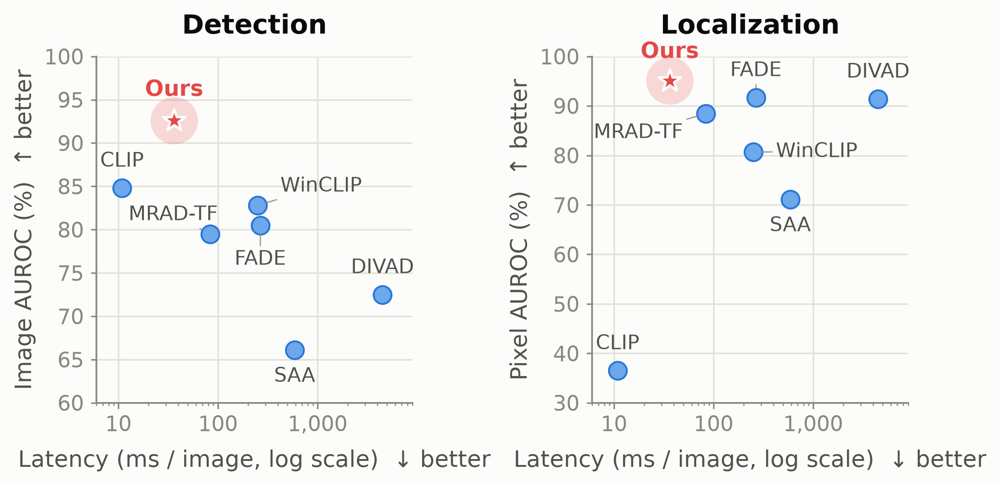
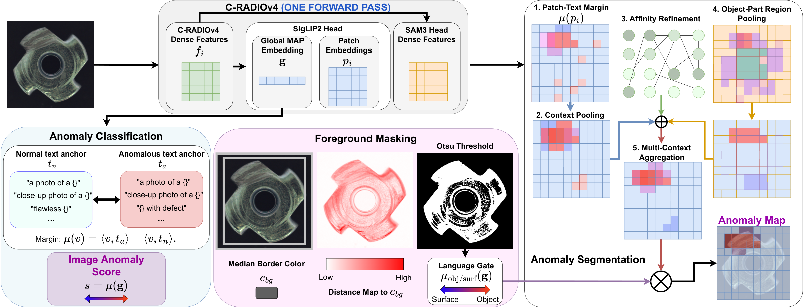
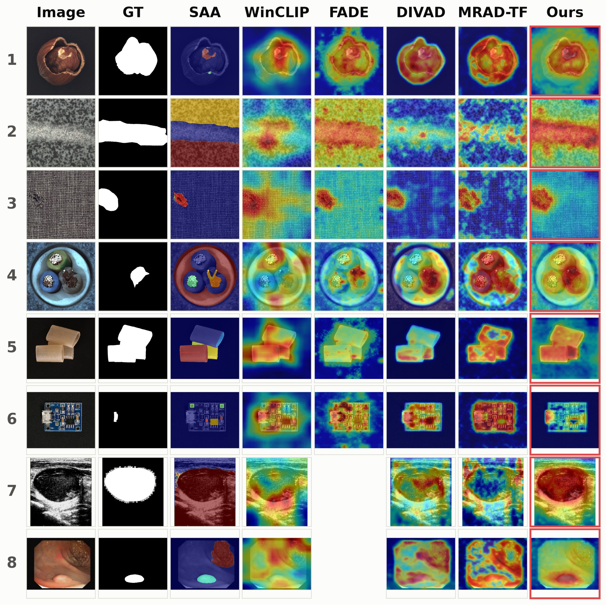

<div align="center">

# RADIOlogy

### A Single-Pass Approach to Training-Free Zero-Shot Anomaly Detection — *WACV 2027*

[](#citation)

[](https://pytorch.org/)
[](#license)

RADIOlogy detects and localizes anomalies with **one forward pass** of a frozen
C-RADIOv4 backbone and a WinCLIP-style prompt ensemble. No training, no
normal reference images, and no test-time adaptation: every signal it uses
(text-aligned patches, a MAP-pooled global embedding, and the structural and
segmentation-aligned dense features) comes out of the same pass.

[Code](https://github.com/jacomof/RADIOlogy) · [Results](#results) · [Citation](#citation)

</div>

<p align="center">
  
  <br/>
  <em>Mean image/pixel AUROC over seven industrial benchmarks vs. latency, training-free methods.</em>
</p>

## Method

<p align="center">
  
</p>

A prompt ensemble (WinCLIP templates × normal/anomalous state words) gives two
text anchors, `t_n` and `t_a`. The anomaly margin of an embedding `v` is
`μ(v) = cos(v, t_a) − cos(v, t_n)`.

- **Image score.** The margin of the MAP-pooled global embedding. The MAP head
  is trained to make the pooled vector text-alignable, so it can be scored
  directly, with no patch aggregation.
- **Anomaly map.** The per-patch margin, refined with signals from the same
  forward pass:
  - *context pooling*: average each patch embedding over a 5×5 window before
    scoring (WinCLIP's windows, done in feature space without re-encoding);
  - *affinity refinement*: diffuse the margin over a patch-affinity graph built
    from RADIO's trunk features;
  - *object-part pooling*: spherical k-means on the SAM3-aligned features
    splits the grid into `K ∈ {8, 32}` parts, each scored as a unit and
    blended with the context field.

  The four resulting fields are averaged, upsampled and smoothed.
- **Foreground mask.** Pixels far from the median border colour are kept
  (per-image Otsu threshold). A language gate, the global margin between
  "object" and "surface/texture" anchors, turns the mask off on images with no
  background, such as textures. Its threshold (0.016) was chosen by
  leave-one-dataset-out validation.
- **Medical vocabulary.** On medical benchmarks the industrial state words
  ("damaged", "with defect") are replaced with clinical ones ("with a lesion",
  "diseased").

## Results

All numbers are zero-shot and training-free, in %. Image-level: AUROC / max-F1.
Pixel-level: AUROC / max-F1 / AUPRO (integrated to 30% FPR). Comparisons with
CLIP, SAA, WinCLIP, FADE, DIVAD and MRAD-TF are in the paper.

| Domain | Dataset | Image AUROC | Image max-F1 | Pixel AUROC | Pixel max-F1 | AUPRO |
|---|---|:-:|:-:|:-:|:-:|:-:|
| Industrial | MVTec AD | 96.0 | 95.1 | 92.2 | 39.0 | 82.9 |
| | VisA | 85.4 | 83.1 | 93.7 | 20.4 | 83.1 |
| | BTAD | 94.4 | 90.1 | 96.2 | 52.9 | 77.8 |
| | MPDD | 77.0 | 82.0 | 94.4 | 24.7 | 85.5 |
| | KolektorSDD¹ | 97.5 | 90.0 | 98.5 | 38.5 | 93.8 |
| | DAGM | 99.6 | 95.8 | 95.3 | 43.7 | 88.6 |
| | DTD-Synthetic | 98.6 | 97.6 | 96.4 | 45.1 | 89.3 |
| | **Mean** | **92.6** | **90.5** | **95.2** | **37.8** | **85.9** |
| Medical | HeadCT | 98.0 | 93.9 | – | – | – |
| | BrainMRI | 96.0 | 94.9 | – | – | – |
| | Br35H | 97.9 | 94.7 | – | – | – |
| | ISIC | – | – | 90.5 | 74.0 | 76.9 |
| | CVC-ClinicDB | – | – | 89.6 | 54.9 | 73.2 |
| | CVC-ColonDB | – | – | 89.5 | 47.8 | 73.5 |
| | TN3K | – | – | 79.5 | 43.4 | 46.9 |
| | **Mean** | **97.3** | **94.5** | **87.3** | **55.0** | **67.7** |

¹ KolektorSDD frames (500×1260) are split into three horizontal bands that are
scored independently and stitched back together.

The full pipeline runs at about 36 ms per image (see the teaser figure for the
latency of every method).

<p align="center">
  
  <br/>
  <em>Anomaly maps from RADIOlogy and the training-free baselines.</em>
</p>

## Installation

```bash
git clone https://github.com/jacomof/RADIOlogy.git && cd RADIOlogy
conda create -n radiology python=3.12 && conda activate radiology
pip install -r requirements.txt
```

The backbone is loaded with `torch.hub.load("NVlabs/RADIO", ...)`. The first
run needs network access to download the RADIO code and weights, which are
then cached under `$TORCH_HOME`. The SigLIP2 teacher weights used to project
patches into the text space are fetched from Hugging Face and cached under
`$HF_HOME`.

## Data

Every benchmark is read in the MVTec AD layout:

```text
<root>/<category>/
    train/good/*.png
    test/{good,<defect_1>,...}/*.png
    ground_truth/<defect_1>/<stem>_mask.png
```

MVTec AD already uses this layout. `src/data_mvtec.py` also knows the category
names of VisA, BTAD, MPDD, KolektorSDD, DAGM, DTD-Synthetic and the medical
benchmarks (BrainMRI, HeadCT, Br35H, ISIC, CVC-ClinicDB, CVC-ColonDB, TN3K)
once they are converted to this layout. Conversion scripts and datasets are
not included; download each benchmark from its original source.

## Usage

**Single-pass evaluation** (paper configuration; prints image and pixel metrics
and throughput):

```bash
python main.py --data-root /path/to/mvtecad --out results.json
```

**Exact reproduction of the paper numbers.** This path caches every
intermediate field, which is also what the ablations use:

```bash
./reproduce_mvtec.sh /path/to/mvtecad
```

It runs three stages: `main_zeroshot.py` encodes the test set and caches the
margin fields, `scripts/zs_text_mask.py` caches the language-gate inputs, and
`scripts/zs_combine.py` combines the fields, applies the foreground mask and
scores the maps.

**Other benchmarks.** Pass `--categories` with the benchmark's category names.
For the medical benchmarks use `--states clinical` in stage 1, and
`--text-vocab anatex --text-gate 0.014` in stage 3.

**Raw-CLIP throughput baseline** (same timing protocol as `main.py`):

```bash
python bench_clip_raw_throughput.py --data-root /path/to/mvtecad
```

Run any script with `--help` to list its options.

## Figures

`figures/` holds the scripts behind the paper's plots. The ablation and teaser
scripts include their data and run directly, e.g.
`python figures/make_ctxk_ablation.py`.

| Script | Figure |
|---|---|
| `make_teaser_speed_accuracy.py` | Accuracy vs. latency, all training-free methods |
| `make_qualitative_comparison.py` | Anomaly maps, ours vs. baselines |
| `make_failure_cases.py` | Failure cases of the foreground mask and of vision-language alignment |
| `make_ctxk_ablation.py` | Context-pooling window size `k` |
| `make_regK_ablation.py` | Single region count `K` |
| `make_regKset_ablation.py`, `make_regKset_stability.py` | Region `K`-set |
| `make_refiters_ablation.py` | Affinity-diffusion iterations |

`make_qualitative_comparison.py` and `make_failure_cases.py` read cached score
maps from our method and from each baseline. Those caches are not included;
set the paths at the top of each script to your own outputs.

## Repository layout

```text
RADIOlogy/
├── main.py                       single-pass pipeline + throughput
├── main_zeroshot.py              stage 1: encode and cache margin fields
├── reproduce_mvtec.sh            three-stage reproduction of the MVTec AD numbers
├── bench_clip_raw_throughput.py  raw-CLIP throughput baseline
├── scripts/
│   ├── zs_text_mask.py           stage 2: cache language-gate inputs
│   └── zs_combine.py             stage 3: combine fields, mask, score
├── src/
│   ├── backbones/                RADIO (and raw CLIP for the baseline)
│   ├── zeroshot.py               prompts, margins, region pooling, affinity refinement, masks
│   ├── basis.py                  the full anomaly map as one linear operator (used by main.py)
│   ├── data_mvtec.py             MVTec-layout dataset loading
│   ├── metrics.py                image AUROC / AP / max-F1
│   ├── pixel_metrics.py          pixel AUROC / AP / max-F1 / AUPRO
│   └── utils.py                  seeding, spatial pooling, I/O
├── figures/                      paper figure scripts and their outputs
└── assets/                       README images
```

## Citation

To be provided soon, once the paper is available on arXiv or in the WACV 2027 proceedings.

## License

The code in this repository is released under the [Apache 2.0 license](LICENSE).
The RADIO models it downloads at runtime are distributed by NVIDIA under their
own license; see the [RADIO repository](https://github.com/NVlabs/RADIO).

## Acknowledgements

This work builds on [RADIO](https://github.com/NVlabs/RADIO) by NVIDIA, which
supplies the backbone and its SigLIP2, DINOv3 and SAM3 adaptor heads. The
prompt ensemble follows [WinCLIP](https://arxiv.org/abs/2303.14814) (Jeong et
al., CVPR 2023). We thank the authors of these works and of the benchmarks we
evaluate on.
